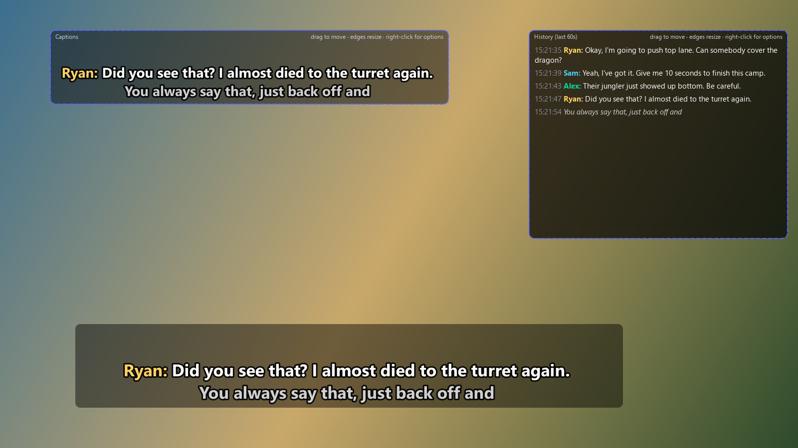
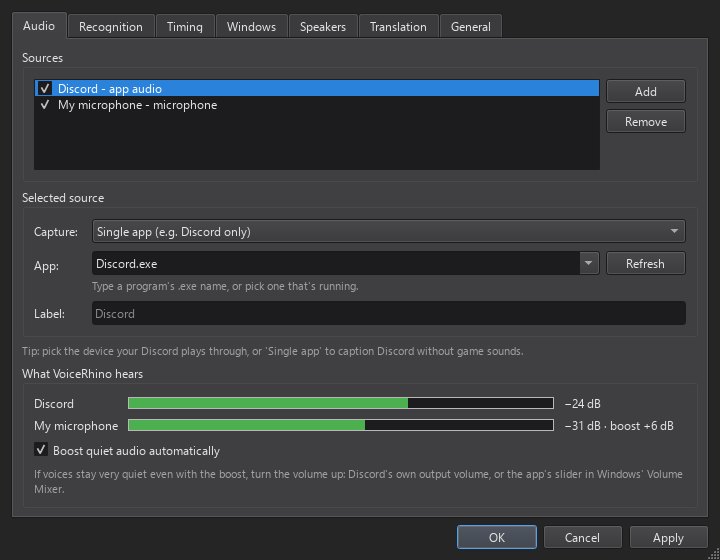
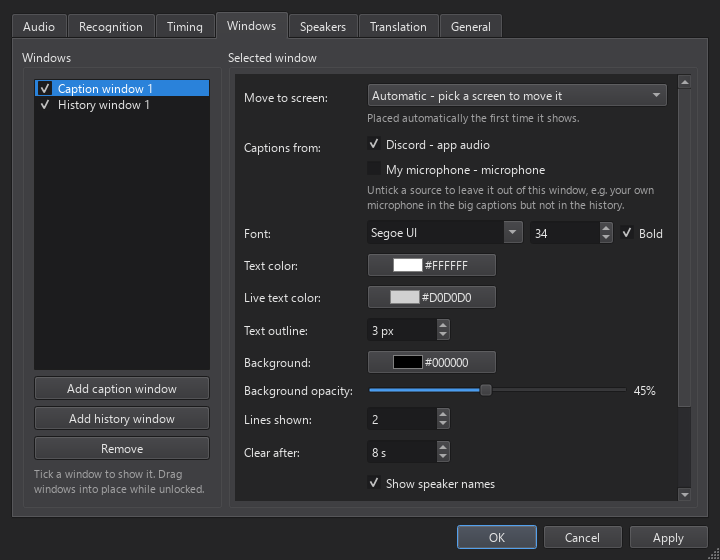
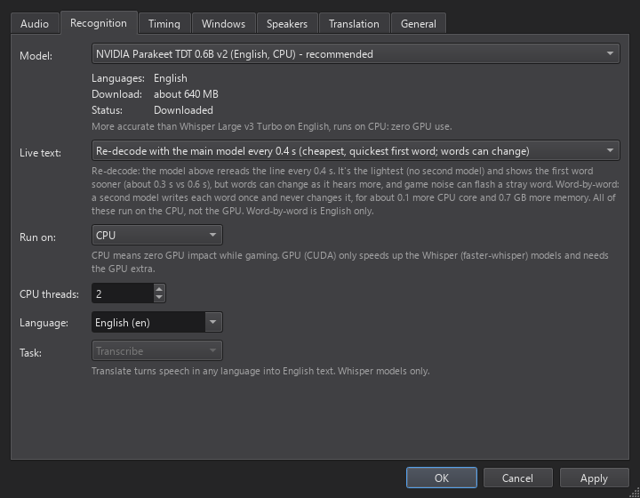
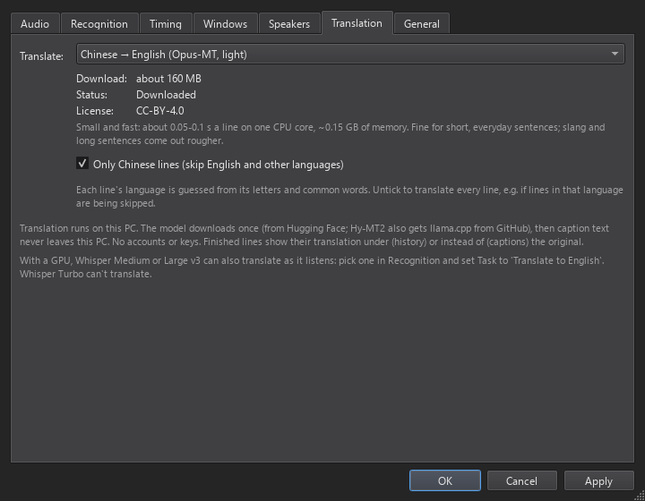
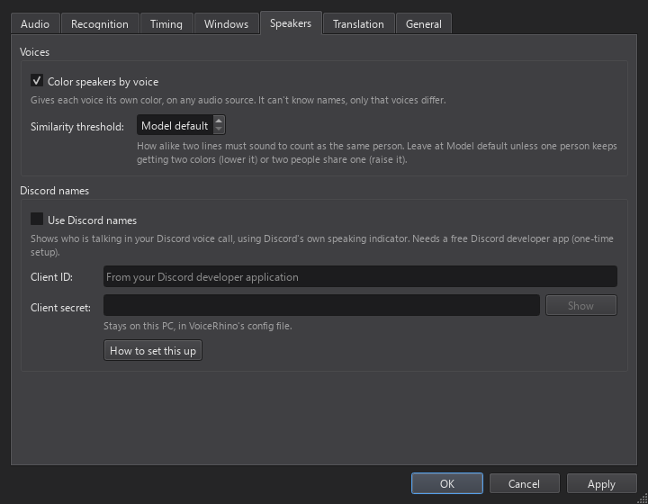
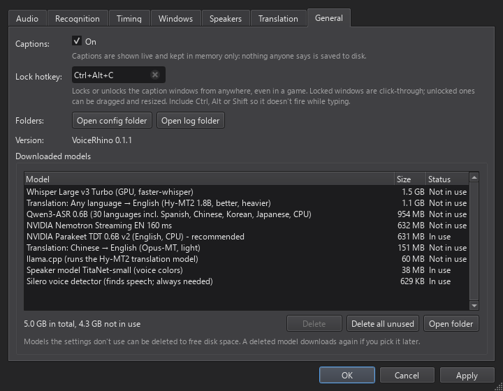

<p align="center">
  
</p>

# VoiceRhino

Live captions. An accessibility tool for people who are deaf or hard-of-hearing
(or who have auditory processing difficulties, or just need to read what's said),
built first for deaf and hard-of-hearing gamers: big click-through captions over the game, a scrollback
window for anything missed, captions from any audio device or a single app (e.g. only
Discord), and recognition that runs on the CPU so the GPU stays free for games.

_Built in honor of a hard-of-hearing gaming friend, and for everyone who wants to follow the conversation._

<p align="center">
  
</p>
<p align="center"><sub>The caption bar (locked: click-through), a second caption window and the
history window (unlocked: dashed frames, drag to move). Names come from voice colors or Discord.</sub></p>

> **Captions, not a recorder.** VoiceRhino shows speech as text on your screen so you can
> follow the conversation. It runs 100% on your PC, with no telemetry, and **never saves
> what anyone says**: captions live in memory only and are gone when you quit. See
> [Responsible use](#responsible-use).

## Quick start

1. Download **`VoiceRhino-<version>.zip`** from the
   [Releases page](https://github.com/brokenrockstudios/VoiceRhino/releases) (under _Assets_ of
   the latest release) and unzip it somewhere it can stay, e.g. `C:\VoiceRhino`.
2. Double-click **`run.bat`**. Windows may warn about a file from the internet: click
   _More info_ → _Run anyway_. The first run installs what it needs (a few minutes: uv,
   Python 3.12 and packages), then the app downloads its speech model (~640 MB) while
   showing progress. After that it starts in seconds.
3. A **CC** icon appears in the system tray and two windows appear with dashed frames:
   the **caption bar** and the **history** window. Drag them where you want them
   (drag edges to resize), on any monitor.
4. Press **Ctrl+Alt+C** to lock them: frames disappear and clicks go straight through
   to the game. Press it again to unlock and move things.
5. Pick what to listen to: right-click the tray icon → **Settings… → Audio**:
    - **Output device – what you hear**: choose the device Discord plays through
      (e.g. _VOIPSpeakers_), or _Default output_ for all PC audio.
    - **Single app**: `Discord.exe` captions only Discord, without game sounds
      (Windows 11 / Windows 10 build 20348+).
    - **Input device**: a microphone, e.g. someone in the same room.
      You can add several sources; captions get labeled with the source name, and each window
      can leave sources out (Settings → Windows → _Captions from_), e.g. your own microphone in
      the history but not in the big captions.

## Requirements and performance

- **Windows 10 or 11, 64-bit.** Single-app capture (e.g. only Discord) needs Windows 11 or
  Windows 10 build 20348+.
- **CPU:** the default model uses about half a CPU core while people are talking and nothing
  while it's quiet. Any recent 4-core or better CPU should be fine. On older or low-power
  PCs it can cost a few FPS in demanding games; the Moonshine models are lighter.
- **Memory:** roughly 1 GB free, plus about 0.7 GB more for word-by-word live text.
- **Disk:** ~0.7 GB for the default model, more for each extra model you try
  (sizes are in Settings → Recognition; Settings → General → _Downloaded models_ lists what's
  on disk and deletes the ones you don't use).
- **GPU:** not needed. The optional Whisper models need an NVIDIA GPU with 2–3 GB free VRAM.

It has mostly been tested on one fast desktop PC so far, so slower machines may behave
differently. Reports are welcome.

## Using it

| Want to…                                  | Do this                                                                                                                                                     |
| ----------------------------------------- | ----------------------------------------------------------------------------------------------------------------------------------------------------------- |
| Move/resize windows                       | Unlock (Ctrl+Alt+C), drag; right-click a window for options                                                                                                 |
| Another caption window (2nd monitor)      | Tray → Windows → Add caption window                                                                                                                         |
| See the last 30–60 s                      | The history window; set its length in Settings → Windows. Mouse wheel scrolls back (unlocked or not click-through)                                          |
| Keep your own mic out of the big captions | Settings → Windows → select the caption window → _Captions from_ (shown when there are 2+ sources)                                                          |
| Bigger text, colors, outline, opacity     | Settings → Windows                                                                                                                                          |
| Snappier or steadier captions             | Settings → Timing (live update interval, pause that ends a line, shortest speech)                                                                           |
| Try another model                         | Settings → Recognition (downloads automatically)                                                                                                            |
| Free disk space from models you tried     | Settings → General → _Downloaded models_: sizes, and _Delete all unused_ (a deleted model downloads again if you pick it later)                             |
| Who's talking (colors/names)              | Settings → Speakers: voice-based colors, or Discord names ([setup](docs/discord-setup.md))                                                                  |
| Translate (e.g. Chinese → English)        | Settings → Translation: pick the language; its model downloads once and runs on your PC ([details](#translation)). Or a Whisper model with Task = Translate |

### Settings

Right-click the tray icon → **Settings…**

<table>
  <tr>
    <td width="50%"><br>
      <b>Audio:</b> what to caption (a device, a single app like Discord, or a mic), with a meter of what VoiceRhino hears</td>
    <td width="50%"><br>
      <b>Windows:</b> font, colors, outline, opacity, lines shown, and which sources each window shows</td>
  </tr>
  <tr>
    <td><br>
      <b>Recognition:</b> the speech model, live text mode, CPU or GPU, and language</td>
    <td><br>
      <b>Translation:</b> other languages into English, on your PC</td>
  </tr>
  <tr>
    <td><br>
      <b>Speakers:</b> a color per voice, or Discord names</td>
    <td><br>
      <b>General:</b> the lock hotkey, and every downloaded model with its size; delete the ones you don't use</td>
  </tr>
</table>

**Quiet audio** is turned up automatically (up to +24 dB; Settings → Audio shows a meter of
what VoiceRhino hears). If voices stay too quiet even then, the caption windows show
"⚠ … is very quiet": turn the volume up in Discord or in the Windows Volume Mixer.
Discord-only capture follows Discord's slider there: if Discord is muted, captions stop.
A caption window shows the warning only along with captions; the history window keeps it up.
To hide it in a window (e.g. over a game), untick Settings → Windows → _Show audio warnings_,
or right-click the window while unlocked.

**Captions in the game:** overlays show over games in _borderless windowed_ mode. Some
games in _exclusive fullscreen_ draw over everything; switch those to borderless, or put
the caption window on a second monitor.

## Games, anti-cheat and competitive play

VoiceRhino doesn't touch games. It listens to audio through the standard Windows APIs that
recording and chat apps also use, draws its captions in its own separate window, and uses a normal
Windows hotkey (and, only with the Hy-MT2 translator, llama.cpp's `llama-server.exe` as a
hidden helper). It doesn't inject into game processes, read or change game memory, hook
graphics, install drivers or log keystrokes, which is what anti-cheat systems look for.
It shouldn't trigger anti-cheat, but no one can promise how every anti-cheat behaves, so
use it at your own risk.

**Tournaments and ranked leagues** sometimes ban third-party overlays, or tools that turn
game sound into something visual. Captions for a deaf or hard-of-hearing player are
normally an accepted accommodation, but ask the organizer first. Capturing only Discord
(Settings → Audio → _Single app_) keeps game sounds out of the captions entirely.

Protected media (e.g. some streaming services in a browser) is blocked from capture by
Windows itself, so those show no captions. It's not an error and nothing gets flagged.

## Models

The default is NVIDIA **Parakeet TDT 0.6B v2** on the CPU. On our test conversation it
gets ~2% word error rate and decodes a sentence in ~0.1 s on 2 CPU threads, with
**no GPU use at all**. For English it's both more accurate and lighter than the Whisper
Large v3 Turbo model.

**Live text** (the words still being spoken) is re-decoded by default: Parakeet rereads the line
every 0.4 s. That's the lightest option and the quickest to show the first word (about 0.3 s),
but words can change as it hears more. When the person pauses, Parakeet writes the finished
line with proper punctuation. Settings → Recognition → _Live text_ can switch to **word-by-word**:
a second, streaming model (NVIDIA Nemotron Streaming, also CPU, ~650 MB download) writes each
word once and never changes it, so the line only grows, for about 0.1 more CPU core and 0.7 GB
more memory, with the first word after about 0.6 s. Word-by-word is English-only.

For other languages, set Settings → Recognition → _Language_ to **Auto-detect** (picking a
multilingual model does this for you) or to the language being spoken: left on English, models
like SenseVoice force other languages into English-sounding words. Recognition never translates;
for English text from another language, use Settings → Translation or Whisper's Translate task.

| Model                          | Languages                                             | Runs on | Notes                                                    |
| ------------------------------ | ----------------------------------------------------- | ------- | -------------------------------------------------------- |
| Parakeet TDT 0.6B v2 (default) | English                                               | CPU     | best English accuracy/speed                              |
| Parakeet Unified EN 0.6B       | English                                               | CPU     | newer (2026); try it against v2                          |
| Parakeet TDT 0.6B v3           | 25 European languages                                 | CPU     | auto-detects language                                    |
| Moonshine Base / Tiny          | English                                               | CPU     | lightest, less accurate                                  |
| SenseVoice Small               | Chinese, English, Japanese, Korean, Cantonese         | CPU     | very fast                                                |
| Qwen3-ASR 0.6B                 | 30 languages incl. Spanish, Chinese, Japanese, Korean | CPU     | most accurate here for non-English; ~2.5× Parakeet's CPU |
| Whisper Large v3 Turbo         | 99 languages                                          | GPU     | the well-known Whisper; needs `install-gpu.bat`          |
| Distil-Whisper Large v3.5      | English                                               | GPU     | needs `install-gpu.bat`                                  |
| Whisper Medium / Large v3      | 99 languages, can translate → English                 | GPU     | set Task = Translate (Turbo can't translate)             |

### Translation

Settings → Translation turns finished lines in another language into English, on your PC:
no accounts, no keys, nothing sent anywhere. Pick one option; it downloads the first time.

| Option                                                                                                                                                            | Download                    | Speed and CPU                                                                                                                | Quality                                                                               |
| ----------------------------------------------------------------------------------------------------------------------------------------------------------------- | --------------------------- | ---------------------------------------------------------------------------------------------------------------------------- | ------------------------------------------------------------------------------------- |
| _Language_ → English (Opus-MT): Chinese, Japanese, Korean, Spanish, French, German, Italian, Russian; Portuguese and _Other languages_ use one multilingual model | 150–180 MB each             | 0.05–0.1 s a line on one CPU core                                                                                            | fine for short, everyday sentences, rough on slang; the multilingual model is rougher |
| Any language → English (Hy-MT2 1.8B)                                                                                                                              | 1.16 GB (model + llama.cpp) | each line keeps 4 CPU cores busy for 0.3–0.8 s on a fast CPU (Ryzen 9 9950X3D), longer on older ones; holds 1–2 GB of memory | clearly better; 33 languages                                                          |

Hy-MT2 can cost frames in CPU-heavy games while it translates; it runs at low priority so
captions come first, but Opus-MT is the safe choice for gaming. Recognition has to write the
other language first, so pick a model for that language in Settings → Recognition (the
Translation tab warns when the current one only writes English). Only lines that look like the
chosen language are translated by default, never English ones. A translation shows under its line
in the history window and replaces it in the caption window.

Models download to `%LOCALAPPDATA%\VoiceRhino\models` (Settings → General → _Downloaded models_
shows each one's size and removes the ones the settings don't use). Settings live in
`%APPDATA%\VoiceRhino\config.json`; the technical log in `%LOCALAPPDATA%\VoiceRhino\logs`.

Models come over HTTPS straight from their official sources: the
[sherpa-onnx releases](https://github.com/k2-fsa/sherpa-onnx/releases) on GitHub (ONNX
conversions of the original models) and Hugging Face for the Whisper models. Translation
models come from Hugging Face too: Hy-MT2 from Tencent's own page, and the Opus-MT models from
CTranslate2 conversions of the University of Helsinki's models published by a community member
(`gaudi`); llama.cpp comes from its official GitHub releases. VoiceRhino doesn't verify file
checksums yet.

### Model credits and licenses

VoiceRhino doesn't include any models; each one downloads from its publisher when you pick
it, under that publisher's license. The licenses below are as published upstream at the time
of writing. Check the model's own page before relying on them, especially for commercial use.

| Model                                                                                                   | Made by                                                                | License              |
| ------------------------------------------------------------------------------------------------------- | ---------------------------------------------------------------------- | -------------------- |
| Parakeet TDT 0.6B v2 / v3                                                                               | NVIDIA                                                                 | CC-BY-4.0            |
| Parakeet Unified EN 0.6B                                                                                | NVIDIA                                                                 | see the model card   |
| Nemotron Speech Streaming EN 0.6B                                                                       | NVIDIA                                                                 | see the model card   |
| Moonshine Tiny / Base (English)                                                                         | Useful Sensors                                                         | MIT                  |
| SenseVoice Small                                                                                        | Alibaba FunAudioLLM                                                    | FunASR model license |
| Qwen3-ASR 0.6B                                                                                          | Alibaba Qwen                                                           | Apache-2.0           |
| Whisper Medium / Large v3 / Large v3 Turbo                                                              | OpenAI (converted by Systran, Mobius Labs)                             | MIT                  |
| Distil-Whisper Large v3.5                                                                               | Hugging Face                                                           | MIT                  |
| Silero VAD (speech detection)                                                                           | Silero                                                                 | MIT                  |
| TitaNet Small, WeSpeaker ResNet34 (voice colors)                                                        | NVIDIA, WeNet community                                                | see the model cards  |
| OPUS-MT translation models (Japanese, Korean, Spanish, French, German, Italian, multilingual → English) | University of Helsinki (Helsinki-NLP); CTranslate2 conversion by gaudi | Apache-2.0           |
| OPUS-MT Chinese → English, Russian → English                                                            | University of Helsinki (Helsinki-NLP); CTranslate2 conversion by gaudi | CC-BY-4.0            |
| Hy-MT2 1.8B (translation, Q4_K_M GGUF)                                                                  | Tencent Hunyuan                                                        | Apache-2.0           |

OPUS-MT models: Jörg Tiedemann and Santhosh Thottingal, _OPUS-MT – Building open translation
services for the World_ (EAMT 2020), University of Helsinki
([Helsinki-NLP on Hugging Face](https://huggingface.co/Helsinki-NLP)), under
[CC-BY-4.0](https://creativecommons.org/licenses/by/4.0/) or Apache-2.0 as listed above; converted
to CTranslate2 (float16) by [gaudi](https://huggingface.co/gaudi) and run as published. Hy-MT2:
Tencent Hunyuan, _Hy-MT2: A Family of Fast, Efficient and Powerful Multilingual Translation Models
in the Wild_ (arXiv 2605.22064), [tencent/Hy-MT2-1.8B-GGUF](https://huggingface.co/tencent/Hy-MT2-1.8B-GGUF).

Speech runs through [sherpa-onnx](https://github.com/k2-fsa/sherpa-onnx) (Apache-2.0) and
[faster-whisper](https://github.com/SYSTRAN/faster-whisper) (MIT); translation through
[CTranslate2](https://github.com/OpenNMT/CTranslate2) (MIT) with
[SentencePiece](https://github.com/google/sentencepiece) (Apache-2.0), and Hy-MT2 through
[llama.cpp](https://github.com/ggml-org/llama.cpp) (MIT). VoiceRhino isn't affiliated with or
endorsed by any of these projects or companies.

## Privacy: everything stays on your PC

- **Speech recognition is local.** Audio is turned into text on your own CPU (or GPU). Audio
  is never uploaded, streamed or stored.
- **Translation is local too** (optional, off by default). The models run on your PC and caption
  text is never sent anywhere. Hy-MT2 runs in llama.cpp's `llama-server.exe`, which VoiceRhino
  starts hidden: it only accepts connections from this PC (127.0.0.1, with a random key), never
  writes what it translates to disk, and closes when VoiceRhino does.
- **No telemetry, no analytics, no accounts, no ads, no crash reporting.** VoiceRhino doesn't
  phone home and has nothing that tracks how you use it.
- **The only network use is what you trigger:**
    - Downloading speech and translation models (from GitHub or Hugging Face), and llama.cpp
      from GitHub for Hy-MT2, the first time you pick one.
    - _Optional, off by default:_ Discord speaker names. VoiceRhino talks to the Discord app
      on your PC, and to discord.com only to sign in and renew that sign-in
      ([setup](docs/discord-setup.md)). No caption text is sent.
- **What's kept on disk:** your settings, the downloaded models and a technical log (status
  and errors, never caption text). Captions themselves live in memory only and are gone when
  you quit; there is no option to save them.
- **Older versions** had an off-by-default _Save a transcript_ option. If you ever turned it
  on, its files (`transcript-YYYY-MM-DD.txt`) are still in `%LOCALAPPDATA%\VoiceRhino\logs`
  (_Settings → General → Open log folder_); delete them if you don't need them.

## Responsible use

VoiceRhino exists so deaf and hard-of-hearing people can take part in conversations,
calls and games like everyone else. Live captions on your own screen work like a hearing
aid: they help you follow along and don't keep anything.

That's deliberate: VoiceRhino has no way to save what's said. Recording or transcribing a
conversation can require the consent of **everyone** in it: many places (e.g. California,
Illinois, Washington, Florida, much of the EU, Germany) require all parties to agree, and
platforms like Discord have their own rules. The history window only holds the last minute
or so, on screen. So:

- **Don't share what people said without their permission.** That includes screenshots of
  the history window.
- **Don't record or screen-capture calls with it** unless everyone agrees. VoiceRhino is
  built for open use and has no hidden or stealth mode.

You are responsible for following the laws and platform rules where you and the people
you talk to live. This isn't legal advice.

## License

VoiceRhino is released under the [MIT License](LICENSE) © Broken Rock Studios LLC. The models
and libraries it downloads or uses keep their own licenses (see
[Model credits and licenses](#model-credits-and-licenses)).

## Disclaimer

VoiceRhino is free, open-source software provided **as is, without warranty of any kind**,
express or implied, including merchantability, fitness for a particular purpose and
non-infringement. In no event are the authors or Broken Rock Studios LLC liable for any
claim, damages or other liability arising from the software or its use, including misuse
by anyone.

- **Captions can be wrong.** Speech recognition mishears words, misses quiet or overlapping
  speech, and can lag or stop (e.g. if audio settings change). Don't rely on VoiceRhino where
  a mistake could cause harm: emergencies, medical, legal, financial or safety-critical
  conversations. Use a professional interpreter or CART captioner there.
- **It's not a medical device** and isn't a substitute for hearing care or professional
  accessibility services.
- **You're responsible for how you use it**, including recording and consent laws, platform
  and game rules (see [Responsible use](#responsible-use) and
  [Games, anti-cheat and competitive play](#games-anti-cheat-and-competitive-play)), and the
  licenses of any models or online services you choose to use.
- **Translations can be wrong too**, more often than captions: they come from small models
  working on what recognition heard, mistakes included.
- **Third-party services** you turn on (Discord) have their own terms and privacy policies.

Product names such as Windows, Discord, NVIDIA and Whisper are trademarks of their
owners and are used only to describe compatibility.

## Troubleshooting

- **Nothing appears:** hover the tray icon; the tooltip shows the status (loading,
  listening to X, errors). Check Settings → Audio points at the device you actually hear.
- **Headset unplugged:** it reconnects automatically when plugged back in.
- **No translations:** the tray tooltip says "Translation ready" once the model has loaded, or
  why it couldn't. Settings → Translation warns when the recognition model only writes English.
  If lines in the chosen language are skipped, untick the checkbox under the model there.
- **Logs:** `%LOCALAPPDATA%\VoiceRhino\logs\voicerhino.log`.
- **Terminal mode** (prints captions, handy for debugging):
  `uv run voicerhino --console --device "loopback:VOIPSpeakers (Realtek USB2.0 Audio)"`
  (see `uv run voicerhino --list-devices`).

## Alternatives and inspiration

VoiceRhino stands on other people's work, and depending on what you need, one of these may suit
you better. Status and features are as of late 2026; check each project for its current state.

| Tool                                                                             | What it is                                                                      | Good to know                                                                                                                                                                                    |
| -------------------------------------------------------------------------------- | ------------------------------------------------------------------------------- | ----------------------------------------------------------------------------------------------------------------------------------------------------------------------------------------------- |
| Windows 11 Live Captions                                                         | Built into Windows (Win+Ctrl+L), on-device, free                                | Follows the default output device only: no per-app capture, no history. [LiveCaptions-Translator](https://github.com/SakiRinn/LiveCaptions-Translator) adds an overlay, history and translation |
| [CaptionsRush](https://captionsrush.com/)                                        | Captions for gamers and Discord, made by a hard-of-hearing gamer                | Closed source. A Discord bot hears each speaker separately, so names are exact                                                                                                                  |
| [LocalVocal](https://github.com/royshil/obs-localvocal)                          | OBS plugin running Whisper locally                                              | GPL-2.0, needs OBS. Its idea (detect speech, re-decode the open line, then finalize) inspired VoiceRhino's pipeline                                                                             |
| [OBS Closed Captioning](https://github.com/ratwithacompiler/OBS-captions-plugin) | OBS plugin with a caption preview window                                        | GPL-2.0, needs OBS. Uses Google's cloud speech API, so audio leaves your PC                                                                                                                     |
| [TMSpeech](https://github.com/jxlpzqc/TMSpeech)                                  | Windows live captions on sherpa-onnx, the same engine family VoiceRhino uses    | MIT, Chinese-meeting focus. A good proof that CPU-only captioning is light                                                                                                                      |
| [Buzz](https://github.com/chidiwilliams/buzz)                                    | Whisper transcription of recordings and live input                              | MIT. Built for files and meetings, not a game overlay; system audio needs a virtual cable                                                                                                       |
| [Vibe](https://github.com/thewh1teagle/vibe)                                     | Offline Whisper transcription app                                               | MIT. File-oriented rather than live overlays                                                                                                                                                    |
| [Ava](https://ava.me)                                                            | Cloud captions in a floating box, with speaker ID and optional human captioners | Free and paid tiers; aimed at conversations and meetings                                                                                                                                        |
| Chrome Live Caption                                                              | Captions for audio played in Chrome                                             | Only hears Chrome, not other apps or games                                                                                                                                                      |
| Dragon and Windows Voice Access                                                  | Dictation and voice control: turn _your own_ speech into text or commands       | A different job: they don't caption what other people say                                                                                                                                       |

Listing here is not an endorsement or a claim of affiliation; names belong to their owners.

## Development

```
uv sync                      # Python 3.12 venv with everything
uv run voicerhino            # GUI
uv run voicerhino --file tests/_out/conversation.wav   # demo with a WAV on loop
uv run pytest                # tests (generate synthetic speech with Windows TTS)
uv run python tools/bench.py parakeet-tdt-0.6b-v2-int8 fw-large-v3-turbo:cuda
uv run python tools/bench.py parakeet-tdt-0.6b-v2-int8 --live nemotron-streaming-en-160ms-int8 --realtime
uv run python tools/screenshot_readme.py   # re-render the README images in docs/images
```

`bench.py` feeds audio as fast as it can by default, which leaves decode time out of the
latencies; `--realtime` plays it at real speed so the numbers match what you'd see on screen.
`--set min_speech=0.25` overrides a Timing setting, `--gain-db -40` turns the audio down.

- `src/voicerhino/audio/` – capture: WASAPI inputs + loopback of any output, per-app capture
- `src/voicerhino/asr/` – model catalog, downloader, engines (sherpa-onnx, faster-whisper)
- `src/voicerhino/pipeline.py` – VAD segmentation, live partials, finals
- `src/voicerhino/ui/` – overlays, history, tray, settings
- `src/voicerhino/speakers/` – voice clustering, Discord speaking events
- `tools/` – benchmark, synthetic test audio, screenshots, manual capture checks
